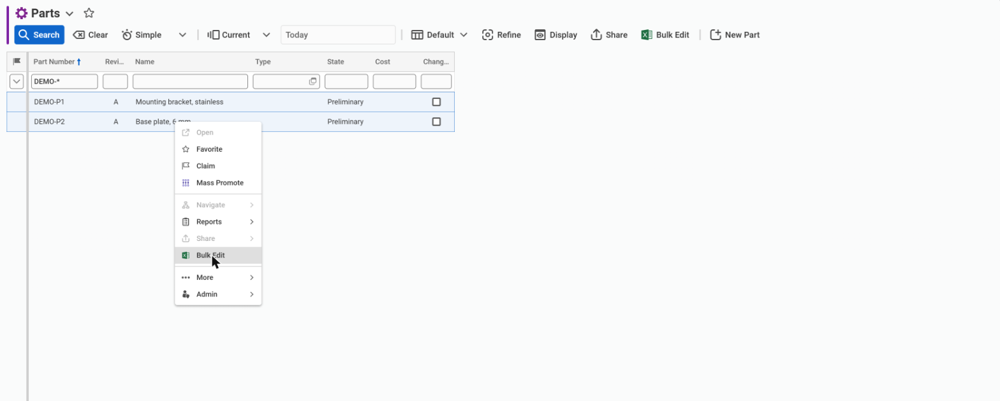
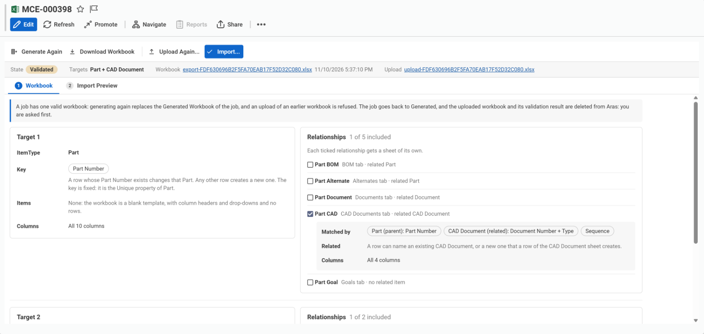
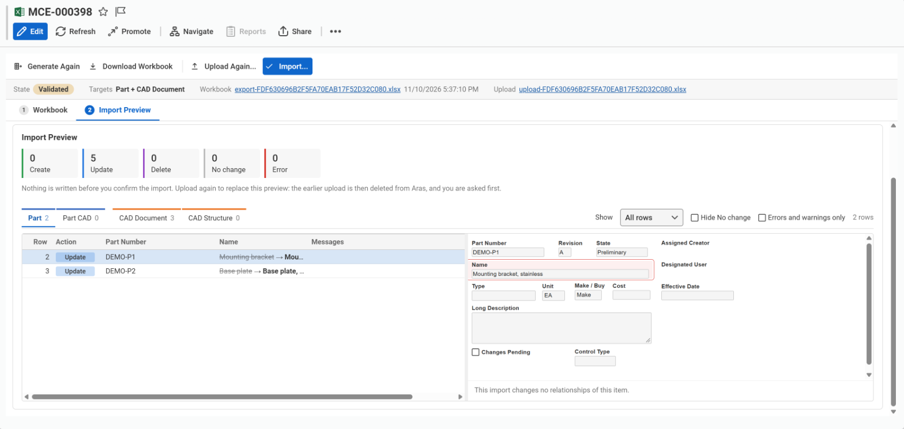
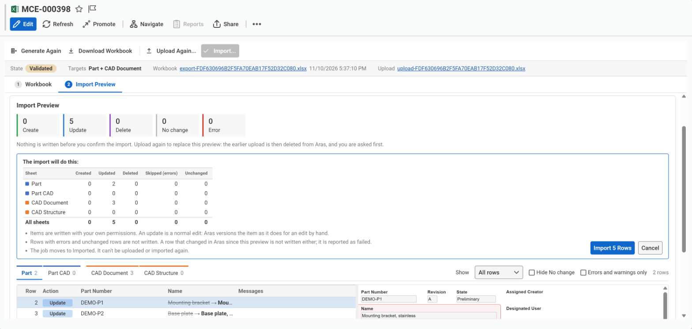
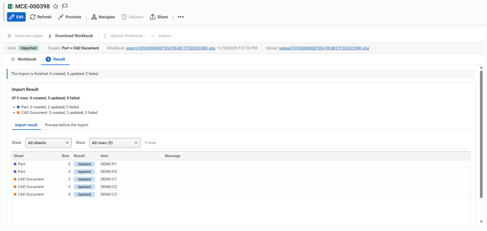

# Mass Create & Edit for Aras Innovator

Create and edit Aras Innovator items in bulk with Excel.



## Why it exists

Changing many items in Aras Innovator by hand means opening, editing and saving them one at a time. Loading new items in bulk usually needs an administrator, AML or a batch loader, and a spreadsheet that nothing checks until the load fails halfway.

Mass Create & Edit puts this in the hands of the users who own the data:

- They work in Excel, in a workbook that already knows the ItemType's rules: its lists, number and date formats, text lengths and required properties.
- They see exactly what an import will do, row by row, before anything is written.
- Everything is read and written with their own permissions, and changes go through normal Aras versioning. The tool gives nobody rights they don't already have.
- Administrators decide which ItemTypes the tool can be used on, and by whom.

## How it works

A **job** guides each workbook from start to finish.

**1. Generate a workbook.** Select items in a search grid and click **Bulk Edit**, or create a new job to start from a blank template. Pick the ItemType, or several, and the relationships that should get a sheet. The tool generates an `.xlsx` workbook with a main sheet for each ItemType and a sheet for each relationship.



**2. Fill it in.** Edit the workbook in Excel. Every column carries Excel validation that matches its Aras property: drop-downs for lists, number and date checks, text lengths. Pick any files the workbook names, such as native CAD files.

**3. Upload and preview.** Upload the workbook back into the job. The server checks every cell and shows each row as **Create**, **Update**, **No change** or **Error**, with its messages. Select a row to see the item's Form with the new values; changed fields are outlined. Nothing is written yet, so fix the workbook and upload it again as often as needed.



**4. Import.** Check the counts per sheet and confirm. The rows without errors are written in batches.



**5. Review the result.** The job lists every row that was created, updated, deleted, failed or skipped. Double-click a row to open its item. The preview stays available, read-only, as it was before the import.



## Requirements

- Aras Innovator **14.0.25 (Innovator 2024) or later**. Tested on 14.0.25 and 14.35 (Innovator 2025).
- **Aras Update 1.18** or later, to install the package.
- An administrator login for the install, and file access to the Innovator code tree (the folder that holds `Client` and `Server`).

The package has no other dependencies. Mass Promote is not required.

## Install

The package is the `1.0.0` folder of this repository. It has two modules:

| Module | What it does |
|---|---|
| **IS** (code tree) | Copies the client files into `Client/customer/masscreateedit/`, updates `filesRevision` in `InnovatorClient.config` so browsers load the new files, and restarts the Client application. It changes no other Innovator file. |
| **DB** (database) | Imports the package's items: ItemTypes, Forms, Methods, identities, permissions, menu entries and the configuration item. |

**With Aras Update:** add the `1.0.0` folder as a local package, choose **FRG_MassCreateEdit**, and install both modules. Aras Update asks for the Innovator folder, the server URL, the database name and an administrator login.

**From the command line:**

```powershell
& "C:\Program Files (x86)\Aras\Aras Update\Aras Update Cmd\ArasUpdateCmd.exe" install FRG_MassCreateEdit -version:1.0.0 `
    -path:"<repository>\1.0.0" -modules:"IS|DB" -packageStorage:"<new empty folder>" `
    -D:Innovator.Dir="<Innovator folder>" -D:Innovator.URL="http://<server>/<web alias>" -D:Innovator.DB="<database>" `
    -D:Innovator.Username="<admin login>" -D:Innovator.Password="<password>"
```

Installing again over an existing install updates the package. It keeps the configuration item as it is, with the administrator's allow-list and limits.

## Set up

1. **Give users access.** Add users, or an identity they belong to, to these identities:
   - **FRG Mass Create & Edit Users** can create jobs and run their own.
   - **FRG Mass Create & Edit Viewers** can read every job.

   Administrators have full rights and need no membership. The third identity, *FRG Mass Create & Edit Steps*, is used by the tool's own Methods. Don't add members to it.
2. **Check the configuration item.** Go to **Administration → Mass Operations → Mass Create & Edit Configuration**. Only Administrators see this entry. The item holds the settings that apply to every job:

   | Setting | Default | Meaning |
   |---|---|---|
   | Allowed ItemTypes | Part, CAD Document, Document | The ItemTypes the tool can be used on. Bulk Edit is hidden on all others, and the server refuses them. Each row has an optional **Identity**: when it is set, only members of that identity (directly or through a group) can use the tool on that ItemType. Leave it empty for everyone. |
   | Maximum Rows per Upload | 5,000 | The most rows on the main sheets of one workbook, counted together. |
   | Maximum Upload Size (MB) | 10 | The largest workbook that can be uploaded. |
   | Items per Import Request | 50 | How many items one import request writes. |
   | Import Requests at Once | 4 | How many import requests one import sends at the same time, from 1 to 8. More is faster on a server with room to spare, and puts more load on it while the import runs. Requests whose rows point at items another request creates wait for it, and requests that touch the same existing item or file go one after the other. Empty means 4. |
   | Largest File to Attach (MB) | 100 | The largest file a file cell can name. |
   | Total Size of Files per Import (MB) | 2,000 | The most the files picked with one workbook may hold together. |
   | Files per Import | 1,000 | The most files that can be picked with one workbook. |
   | Allowed File Extensions | (any) | When set, a comma-separated list such as `pdf, dwg, step`: a file cell can name only files with these extensions. |

   The install creates the item once, as **Default**. Polymorphic ItemTypes can't be put on the allow-list. An allow-list identity limits Administrators too, so add them to it if they should keep using the tool on that ItemType. Users see a change after they load the client again.

## Use

### Start a job

A job is an item of the **Mass Create & Edit** ItemType. It holds the choices made for one workbook, from generating it to the import.

- **Edit existing items:** in the search grid of an allowed ItemType, select rows, then click **Bulk Edit** on the search toolbar or in the right-click menu. The job opens with those items selected. Items can be removed from, or added to, the selection before the workbook is generated.
- **Create items:** go to **Administration → Mass Operations → Mass Create & Edit** and create a new job. Pick the target ItemType. The workbook is a blank template. A row whose key matches an existing item still updates that item, so creating and editing can be mixed.
- **Several ItemTypes in one workbook:** on the *Workbook* tab of a Draft job, click **Add Target** below the last target, for example to create Parts and their CAD Documents together. Each target gets the same choices as the first: its key, its selected items, its relationship sheets and its columns. Each ItemType can be a target once. In the workbook and on the *Import* tab, each target's main sheet is followed by its relationship sheets, and the tabs of one target share a colour.

The job opens as one tool that fills its window:

- a **toolbar** with *Generate Workbook*, *Download Workbook*, *Upload Workbook...* and *Import...*. The button for the next step is filled in, and a disabled button gives the reason in its tooltip;
- a **header** with the job's state, its targets and links to its workbooks;
- two numbered **steps**, *Workbook* and *Import* (*Import Preview* once a workbook is checked). The job opens on the step that comes next.

### Workbook

- **Key.** Each row is identified by the ItemType's Unique properties. A row whose key exists in Aras changes that item; any other row creates a new one. An ItemType without Unique properties is create only.
- **Relationship sheets.** Click *Edit* on the job, then tick the relationships that should get a sheet. The sheets, their layout, their match columns and the columns of every sheet are chosen while the job is being edited; otherwise the tool only shows them. Only relationships that can be a sheet are listed, one level deep. A sheet is named after its RelationshipType, such as *Part CAD*, so it is clear which target it belongs to. For each sheet, *Change...* next to *Matched by* picks the columns that find an existing relationship row. The default is the parent's key, the related item's key and Sequence.
- **Indented BOM.** A *Part BOM* sheet of a Part job can be written as an indented structure: switch its *Layout* from *Flat* to *Indented*. No other relationship has this option. The sheet gets a *Level* column instead of the parent columns. With items selected, it lists each of them on level 0 with its BOM at every level, and a part used in several places is listed in full in each. Without a selection it starts empty. Existing lines are matched on parent and child by default; *Change...* picks other columns, as on any relationship sheet. With Sequence among them, every line needs a Sequence and the same part can be listed more than once under a parent.
- **Columns.** Every sheet has a column for each property that can be imported. Click *Select Columns...* next to *Columns* to leave some out, for the main sheet and for each relationship sheet. A column left out is not in the workbook, and an import leaves that property as it is. The key, the match key, the parent and related item columns and required properties without a default can't be left out.
- **Generate Workbook.** The workbook is downloaded and also stored on the job as its *Generated Workbook*. Generating again replaces it. If the job holds an upload, you are asked first, because the upload is deleted too.

### Fill in the workbook

- **A blank cell leaves the value unchanged.** Type `#CLEAR` to empty a value.
- **Item properties** take the item's keyed name, exactly as Aras shows it. The current generation is used. They name items that exist in Aras, not items another row of the workbook creates. On relationship sheets, the related item is named by its Unique key columns.
- **Files.** A file cell takes a file name: a File property such as *Native File* on a CAD Document, or the file name column of a sheet of files such as *Document File*. Pick the files with the workbook, before it or after it. A cell that keeps the name of the current file, with no picked file of that name, leaves the file as it is.
- **Deleting a file row.** A sheet of files has a *Delete* column. Choose `#DELETE` in it to delete the row it matches. The File itself stays in Aras.
- **Lists, classifications, numbers, dates and text lengths** are checked by Excel as you type. Excel does not check pasted values; the server checks every value again on upload.
- **The sheets are protected.** The header row and the hidden columns are locked, and rows can't be inserted (except on an indented sheet), deleted or sorted. Every data cell can be edited. A hidden `_meta` sheet ties the workbook to its job.
- **An indented BOM.** Level 0 is a top assembly and writes no BOM line; only its part number is read. A row's parent is the nearest row above it one level up. Every part must already exist or be on the Part sheet of the workbook. Choose `#DELETE` in the *Delete* column to delete a line; the part stays in Aras, and so do the lines below it. A subassembly's lines are the same in every place it is used, so change or delete them in each place, or list them in only one. A part used in several places must have the same components in each, or list them in only one place; when they differ, choosing one of the rows in the preview shows the places side by side. A part inside itself is refused when the loop is on the sheet; a loop through BOM lines that are only in Aras is not detected, and Aras accepts it.
  - Sequence is optional. A new line without one is numbered in sheet order, after the lines its parent already has; an existing line keeps its own.
  - A subassembly can stand in several places. Its lines are written once. List the same lines each time, or list them once; different lines in two places are errors.
  - The same part twice directly under one parent is an error: put it on one row with the total quantity.
  - A row that has an error, and every row below it, is not imported. A subassembly that also stands somewhere else without an error is still imported there.
  - Lines a parent has in Aras that the sheet does not list stay on the BOM, with a warning.

### Import

1. **Upload** the workbook with *Upload Workbook...*, or drop it on the *Upload* card of the *Import* step. The workbook must be the one the job generated last; an earlier workbook is refused. Pick the files its file cells name with it, or pick them before or after it, as files or as a folder. The *Files* list of the *Upload* card shows the picked files and which rows name them; add or remove files there, and the workbook is checked again. *Copy* copies a file's name or path as a file cell takes it, and *Copy All* copies the whole *File* column, one file to a line, to paste down a column of the workbook. Nothing is written yet, and no file is stored yet.
2. **Review the preview.**
   - The counts above the grid show how many rows each action has. Each row shows its action (*Create*, *Update*, *Delete*, *No change* or *Error*), in the action's colour, and its messages.
   - Filter the grid to one action, hide *No change* rows, or show only errors and warnings.
   - Select a row to see the item's Form with the new values. Changed fields are outlined. Below the Form, the relationships the import changes for that item each have a tab, as on an item's own page; fold them away to give the Form more room. Above the Form, the preview adds only what the grid, the Form and the tabs don't show, such as a changed property that has no field on the Form.
   - The Form is read-only. It doesn't show what the server sets when the item is saved: numbers from sequences, state, revision or generation, dates, and values set by server events.
   - The preview opens nothing for editing: no lock, no save.
3. **Fix and upload again**, if needed. A new upload replaces the earlier one, and you are asked first, because the earlier upload is deleted.
4. **Import.** Click *Import...*, check the counts per sheet, and confirm with *Import N Rows*. The rows without errors are written in batches. Before each batch, the files it links are stored in Aras. The picked files are not stored before the import, so after the client is reloaded the *Files* list asks for them again. Rows with errors are skipped. When the import finishes, the job is *Imported*, and its result lists every row that was created, updated, deleted, failed or skipped because of errors. With several targets, it also counts the rows of each target, and can be filtered by sheet. Double-click a created or updated row to open its item. *Preview before the import* shows the preview again, read-only, as it was before the import; its relationship tabs list only the rows of the workbook.

A job goes through the states **Draft → Generated → Validated → Imported**. Only the tool's steps move it from one state to the next.

## Good to know

- **Access.** Every item is read and written as the user, and Aras permissions apply. A key that matches an item the user can't see is reported as an error, without revealing the item. That includes items hidden by a MAC policy. Released or locked items the user may not edit are row errors.
- **Versioning.** An update is a normal Aras `edit`. A versionable item gets a new generation, as it would when edited by hand.
- **Changed since the workbook was generated.** If an item changed in Aras after that, the row gets a warning, not an error.
- **New items and their relationship rows** can be in one workbook. A relationship row may point at an item that a new row of any main sheet creates, such as a BOM of new Parts, or a Part CAD row that names a new CAD Document. The import creates the item before the rows that point at it. Items that point at each other are written in one batch; when such a group is larger than a batch, the preview warns that some of its rows may fail.
- **Relationship rows** are added and updated. Only the rows of a sheet of files and of an indented BOM can be deleted, with `#DELETE`.
- **Files** are stored only when the import runs. A file that was stored and that no row ended up linking, because its row failed, is deleted again when the import finishes. A CAD Document is not versioned by an edit, so a new file replaces the old one in place; the preview warns about that.
- **Multilingual strings** are read and written in the session language only.
- **Not supported in this version:** polymorphic ItemTypes, Extended Classification, and relationships more than one level deep, other than an indented Part BOM.

## Repository layout

| Path | Contents |
|---|---|
| `1.0.0/` | The Aras Update package: `package.config`, the client files under `Innovator/Client/customer/masscreateedit/`, and the database items under `Imports/FRG_MassCreateEdit/`. |
| `src/methods/` | The source of every server and client Method. Each must equal the `method_code` of its exported item under `1.0.0/Imports/FRG_MassCreateEdit/Method/`. A test checks this. |
| `src/tests/` | Unit tests for the client modules and the Method sources. |
| `docs/images/` | The screenshots in this README. |

## Development

The unit tests need only Node.js (tested with Node.js 24):

```powershell
cd src/tests
node --test
```

To change a Method, edit its source in `src/methods/`, save the same code into the Method item in Aras, and export the item into `1.0.0/Imports/FRG_MassCreateEdit/Method/`. When you change client files, raise `CLIENT_VERSION` in `FRG_MCE_JobFormPopulated` so that open browsers load the new files.

## License

[MIT](LICENSE). The package and its tests have no third-party code: the package writes and reads .xlsx files itself, and the tests check those files with a reader of their own.
